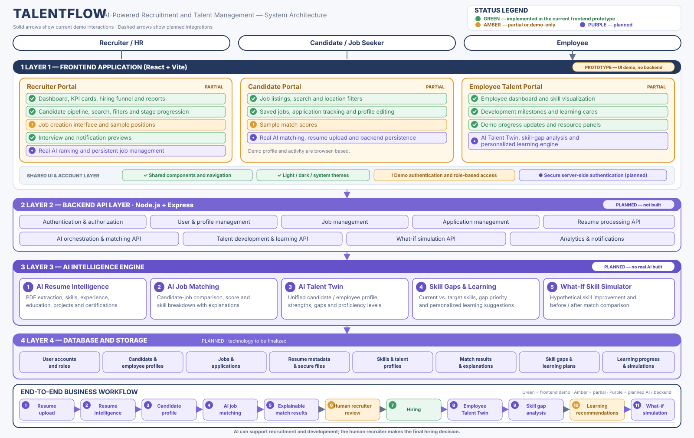

# Talentflow

Talentflow is a responsive React prototype for a connected talent experience. It brings recruiter, candidate, and employee workspaces together with light, dark, and system theme options.

This is a front-end demo with illustrative content. It has no backend, and no AI model or inference service is connected.

## System architecture



Green marks working frontend demo interactions, amber marks partial or demo-only features, and purple marks planned backend, AI, and storage work. The diagram shows the current prototype separately from proposed integrations.

## Workspaces

- **Recruiter:** review hiring metrics, open roles, candidate pipeline, interviews, and talent insights; search and filter candidates, draft positions, and export sample data.
- **Candidate:** browse and filter sample jobs, save roles, track demo applications, and update a profile preview.
- **Employee:** review sample skills and development milestones, update goals, and continue learning activities.

Each workspace has its own sign-in and registration flow. Create an account with a name, email, and password of at least eight characters, then sign in through the same workspace. An email address can be registered to only one role.

## Get started

### Requirements

- Node.js (current LTS recommended) and npm
- A modern browser with Web Crypto support

### Install and run

```sh
npm install
npm run dev
```

Open the local URL printed by Vite, usually <http://localhost:5173>. Select a workspace and register a demo account to explore its dashboard.

## Available scripts

| Command | Description |
| --- | --- |
| `npm run dev` | Start the local development server. |
| `npm run build` | Create the production bundle in `dist/`. |
| `npm run preview` | Preview the production build locally. |
| `npm run lint` | Run Oxlint. |

## Routes

| Path | Screen |
| --- | --- |
| `/` | Landing page |
| `/portals` | Workspace selection |
| `/login/recruiter` | Recruiter sign-in and registration |
| `/login/candidate` | Candidate sign-in and registration |
| `/login/employee` | Employee sign-in and registration |
| `/dashboard/recruiter` | Recruiter workspace |
| `/dashboard/candidate` | Candidate workspace |
| `/dashboard/employee` | Employee workspace |

Dashboard sections are client-side views within each workspace and do not have separate URL routes.

## Demo data and privacy

Accounts and profile edits are stored in the current browser's local storage. Passwords are stored as salted PBKDF2-SHA-256 hashes, not plaintext. The **Remember me** option stores the demo session in local storage; otherwise it lasts for the current browser tab. This browser-only flow is not production authentication: users can inspect or change browser storage, and client-side checks cannot enforce identity or access. Do not use real passwords or sensitive personal information.

People, companies, jobs, match scores, charts, activity, interviews, and dashboard figures are sample content. Demo actions stay in the browser and do not contact external services. Match indicators and skill values are not generated assessments.

## Project structure

```text
src/
  App.jsx       Screens, routing, dashboards, and shared UI
  App.css       Component and responsive styles
  auth.js       Browser-only demo account and session helpers
  index.css     Global styles and theme tokens
  main.jsx      React application entry point
public/         Static icons and favicon
```

## Technology

React 19, Vite 8, Web Crypto, JavaScript, CSS, and Oxlint.
